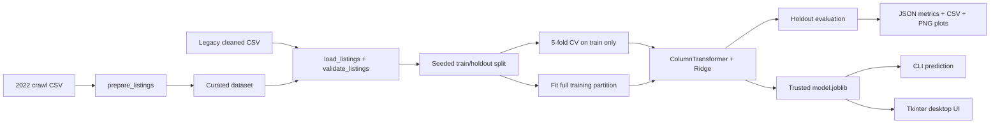

# Architecture

The maintained execution path is a small Python package and a serialized
scikit-learn Pipeline. Model selection, preprocessing and Ridge are fitted
together within each cross-validation fold, preventing category and numeric
statistics from leaking across folds.

## Component boundaries

- `data.py`: CSV ingestion, schema checks, removal of exact duplicate rows.
- `preprocess.py`: optional historical filtering from the raw crawl CSV.
- `model.py`: category one-hot encoding, numeric scaling, Ridge, input contracts.
- `experiment.py`: experiment orchestration, seeded splits, CV, baseline and outputs.
- `plots.py`: headless diagnostic plots using predictions from the actual holdout.
- `cli.py` and `gui.py`: presentation interfaces sharing the fitted artifact.
- `config.py`: validated tunable settings injected into the experiment.

The existing `Crawl/divar_crawler` Scrapy package is a historical data source,
not a required part of the modeling package. The old Keras GUI is also retained
as a reference and is intentionally not connected to the new artifact.

## Explicitly deferred

A live crawl, hosted inference service, updated Keras training, or automatic
model retraining would require additional maintenance and validation. Neither a
server deployment nor Docker has been introduced for this local-only workflow.
